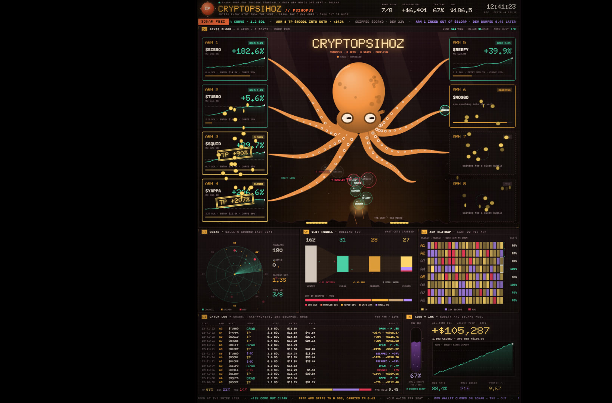

# Psihopus

**An 8-arm pump.fun trading terminal.** One operator. Eight seats. Every mint is sniffed at the vent; clean ones get grabbed, rugs get inked out of.

by [@cryptopsihoz](https://x.com/cryptopsihoz) · [Live demo](https://rimtoln.github.io/psihopus/)



---

## What it is

Psihopus is a live 8-seat pump.fun floor. An octopus sits in the middle of the abyss: each arm is wired to one seat. New mints rise from the vent, hit the sniff line, and either get grabbed, skipped, or inked out of when the dev wallet closes on sonar.

You open one HTML file. The floor is already running.

## Floor layout

1. **THE VENT.** New mints bubble up from the floor. About 18% come out clean.
2. **SNIFF LINE.** Contract read: dev share, bundles, top-10, late curve, CT shill. Dirty bubbles get a tag and drift off.
3. **8 ARMS / 8 SEATS.** A free arm reaches in 0.55 s, carries the mint to its seat in 0.6 s, and holds 6–13 s.
4. **SONAR.** Wallets around each seat: organic, sniper, dev. When the dev marker closes in, the arm inks out.
5. **VENT FUNNEL.** Rolling 60 s: vented → clean → grabbed → closed, plus why the rest were skipped.
6. **ARM HEATMAP.** Last 22 outcomes per arm: take-profit, ink escape, rug.
7. **CATCH LOG.** Live tape of GRAB / TP / INK / RUG with size, entry, exit, result.
8. **TIDE + INK SAC.** Session equity curve and escape fuel. Ink costs 30% per escape, refills at 4%/s.

## Specs

| | |
|---|---|
| Frame | 960×1200 (4:5) |
| Seats | 8, one per arm |
| Clean rate | ~18% of vented mints |
| Hold | 6–13 s per seat |
| Outcomes | TP 68% · INK 22% · RUG 10% |
| Take profit | into KOTH, never through migration |
| Ink sac | −30% / escape · +4% / s refill |
| Dependencies | none for logic; fonts from Google Fonts |

## Quick start

- **Online:** https://rimtoln.github.io/psihopus/
- **Offline:** download `index.html` and open it in Chrome.

**Controls:** `Space` pause · `F` fullscreen · double-click the stage for fullscreen.

On a 1920×1080 monitor the fullscreen frame is 864×1080, centered.

## Project

```
index.html                 the terminal (same file as the live demo)
versions/psihopus-v1.0.html frozen release
media/poster.jpg           still from the floor
docs/HOW-IT-WORKS.md       pipeline, seats, sonar, ink
docs/CONTROLS.md           keys and display size
CHANGELOG.md
LICENSE
```

## License

[MIT](LICENSE)
